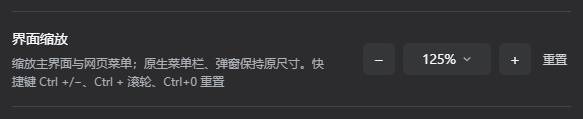
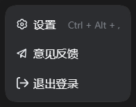

# DSH UI Zoom

为 DeepSeek Harness（DSH）桌面端补上**界面缩放**：50%–400% 分级、键盘快捷键、`Ctrl + 滚轮`，选择按浏览器保留。





> 社区插件，非 DeepSeek 官方产品。已在 **DSH 0.2.1-rc.2（Electron 桌面端）** 上验证。插件包位于仓库的 `dsh-ui-zoom/` 子目录。

## 功能

- **11 档缩放**：50 / 60 / 70 / 80 / 90 / 100 / 110 / 125 / 150 / 200 / 400 %
- **设置入口**：设置 → 通用 → 界面缩放，`−` / `+` 逐级切换，点百分比打开下拉直选，非 100% 时显示「重置」
- **快捷键**：`Ctrl + =` / `Ctrl + -` 缩放，`Ctrl + 0` 重置
- **滚轮**：`Ctrl + 滚轮` 缩放，触控板捏合同样生效
- **按浏览器记忆**：写入 `localStorage`，刷新与重启后保留，同 profile 的其他窗口即时同步
- **覆盖官方字号快捷键**：`Ctrl +/-` 不再改字号，改为缩放界面（字号设置仍可在同一页调整）
- **网页菜单同步缩放**：账号、工作区、模型等下拉菜单随界面放大，并自动重算位置，不会被推出屏幕
- **首帧生效**：Host 在页面绘制前注入缩放，刷新时不会先闪一下 100%

## 安装

前置：已安装 DSH 桌面端，版本 **0.2.1-rc.2**（其他版本未验证）；测试脚本需要 Node.js 22+。

### 桌面端（推荐）

DSH 桌面端的 `desktop` profile 由 Electron 管理，推荐手动登记：

1. 把仓库放到任意目录，例如 `C:\plugins\dsh-ui-zoom-repo`。
2. 先退出 DSH，备份并编辑 `~/.dsh/profiles/desktop/package.json`（只添加下面两个条目，保留原有内容）：

```jsonc
{
  "dependencies": {
    "@local/dsh-ui-zoom": "link:C:/plugins/dsh-ui-zoom-repo/dsh-ui-zoom"
  },
  "dsh": {
    "profile": {
      "bundles": [
        // …原有条目…,
        "@local/dsh-ui-zoom"
      ]
    }
  }
}
```

3. 在 profile 的 `node_modules` 下建立目录链接：

```bat
:: Windows（命令提示符）
mkdir "%USERPROFILE%\.dsh\profiles\desktop\node_modules\@local"
mklink /J "%USERPROFILE%\.dsh\profiles\desktop\node_modules\@local\dsh-ui-zoom" "C:\plugins\dsh-ui-zoom-repo\dsh-ui-zoom"
```

```bash
# macOS / Linux
mkdir -p ~/.dsh/profiles/desktop/node_modules/@local
ln -s /path/to/dsh-ui-zoom/dsh-ui-zoom ~/.dsh/profiles/desktop/node_modules/@local/dsh-ui-zoom
```

4. **完全退出并重新启动 DSH**（首帧脚本属于 Host 代码，刷新页面不够）。

### Web profile / CLI

使用 Web profile 时可以直接用 CLI 安装：

```bash
git clone https://github.com/<your-name>/dsh-ui-zoom.git
cd dsh-ui-zoom
dsh plugin --profile web add link:"$(pwd)/dsh-ui-zoom"
```

重启 DSH 后生效。

### 验证安装

打开 **设置 → 通用**，应看到「界面缩放」一行；按 `Ctrl + =`，界面应立即放大一级。

## 使用

| 操作 | 行为 |
| --- | --- |
| 设置 → 通用 → 界面缩放 | 选择 50%–400% 的任一档位 |
| `Ctrl` / `Cmd` + `=` 或 `+` | 放大一级 |
| `Ctrl` / `Cmd` + `-` | 缩小一级 |
| `Ctrl` / `Cmd` + `0` | 重置为 100% |
| `Ctrl` + 滚轮上 / 下 | 放大 / 缩小 |

缩放与官方的**字号**设置互不覆盖：字号改的是正文、代码与终端的文本大小，缩放改的是主界面整体比例。

## 实现原理

- **Host 半（`index.js`）**：每次返回 `index.html` 时注入一段首帧脚本。脚本优先读取 `localStorage` 中的浏览器选择，读不到才使用 `cordis.patch.yml` 的默认 `zoom`，因此刷新不会闪烁。
- **Client 半（`client.js`）**：注册 `settings.general.item` 设置行；把缩放应用到 `#root`；监听 `keydown` 与 `wheel`；对网页菜单做单独缩放与位置校正。
- **为什么缩放 `#root` 而不是 `<body>`**：菜单与弹窗由 React 门户挂到 `document.body`，并用 `getBoundingClientRect()` + `offsetHeight` 计算视口坐标。缩放 `<body>` 会把这些内联坐标**二次缩放**——125% 时左下角账号菜单的 `top` 会从 721px 变成 901px，正好落到 905px 视口之外，表现为“点了没反应”。
- **网页菜单如何既放大又不跑偏**：`installOverlayZoom` 监听 body 下 `role="menu"` / `role="listbox"` 的门户，用最后一次 `pointerdown` 的触发元素作锚点，重算视觉坐标后除以 zoom 写回，并给面板应用同一 zoom。
- **快捷键如何覆盖官方字号**：官方主题在 `window` 冒泡阶段处理 `Ctrl +/-`，并会跳过 `defaultPrevented` 事件。本插件在**捕获阶段**拦截并 `stopImmediatePropagation()`，官方处理器收不到按键，字号保持不变。

## 兼容性

- **DSH**：0.2.1-rc.2 桌面端已验证；Web profile 理论可用，未做完整回归。
- **系统**：Windows 已验证；macOS / Linux 的链接安装方式见上，未实测。
- **Node.js**：测试脚本需要 22+。

## 已知限制

- **原生菜单栏无法缩放**：左上角「应用 / 编辑」及其下拉由 Electron/Windows 原生绘制，DOM 中不存在对应节点，CSS 与页面脚本都改不到；任何页面内缩放（包括浏览器自身缩放）都不会改变原生菜单。
- **设置弹窗、确认框保持 100%**：它们尺寸固定（设置弹窗 800×800），125% 时会变成 1000×1000 超出视口，缩放会裁切内容。
- **右侧边栏的固定头部在非 100% 时可能错位**：其工具栏使用固定定位，`zoom` 会把包含块宽度放大到 1.25 倍，右侧图标可能被推到视口外；收起右侧边栏时不受影响。
- **按浏览器保存**：选择写入 `localStorage`，不写入 Host 设置文档，不跨浏览器/设备同步。
- **终端**：侧栏终端（xterm）是 canvas 控件，非整数倍率下可能有轻微重采样。
- **快捷键参考面板**：仍会显示官方的「字号增大/减小 Ctrl+=/-」条目；本插件刻意不注册同键位的 fixed 命令，避免参考列表出现两条冲突项，实际行为以本插件为准。

## 目录结构

```
.
├── README.md
├── LICENSE
├── .gitignore
├── docs/
│   ├── settings.png          # 设置行截图
│   └── menu.png              # 菜单缩放截图
└── dsh-ui-zoom/              # 插件包（package.json 所在目录）
    ├── package.json
    ├── index.js              # Host 半：首帧注入
    ├── client.js             # Client 半：设置行、缩放、快捷键、浮层校正
    ├── cordis.patch.yml      # 向 profile 插入 ui-zoom 行
    ├── icon.svg
    ├── locale/
    │   ├── zh.json
    │   └── en.json
    └── test/
        ├── hosttest.mjs
        └── simulate.mjs
```

## 开发与测试

```bash
node dsh-ui-zoom/test/hosttest.mjs
node dsh-ui-zoom/test/simulate.mjs
```

两套脚本都不需要启动 DSH：

- `hosttest.mjs`：校验 Host 半的默认值钳制与首帧脚本。
- `simulate.mjs`：用桩 `window` / `document` / React 跑 Client 半的运行时、持久化、快捷键、滚轮与清理逻辑。

## 发布到 npm

当前包名 `@local/dsh-ui-zoom` 与 `"private": true` 面向本地 `link:` 安装。要发布到 npm：

1. 把 `package.json` 的 `name` 改成你自己的 scope（例如 `@your-name/dsh-ui-zoom`），并移除 `"private": true`。
2. 同步修改 `client.js` 中 `__ModuleLoader__.load({ id: ... })` 与 `cordis.patch.yml` 的 `name`，三者必须与包名一致。
3. 更新已安装 profile 的依赖与 `bundles` 条目。
4. 执行 `npm publish ./dsh-ui-zoom`。

## License

[MIT](LICENSE)
